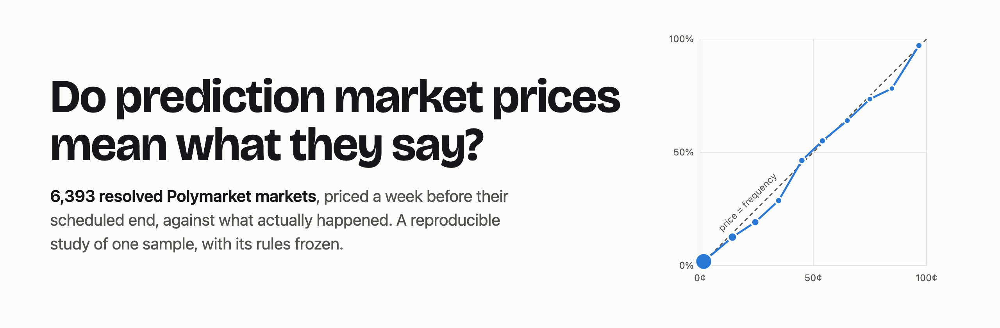
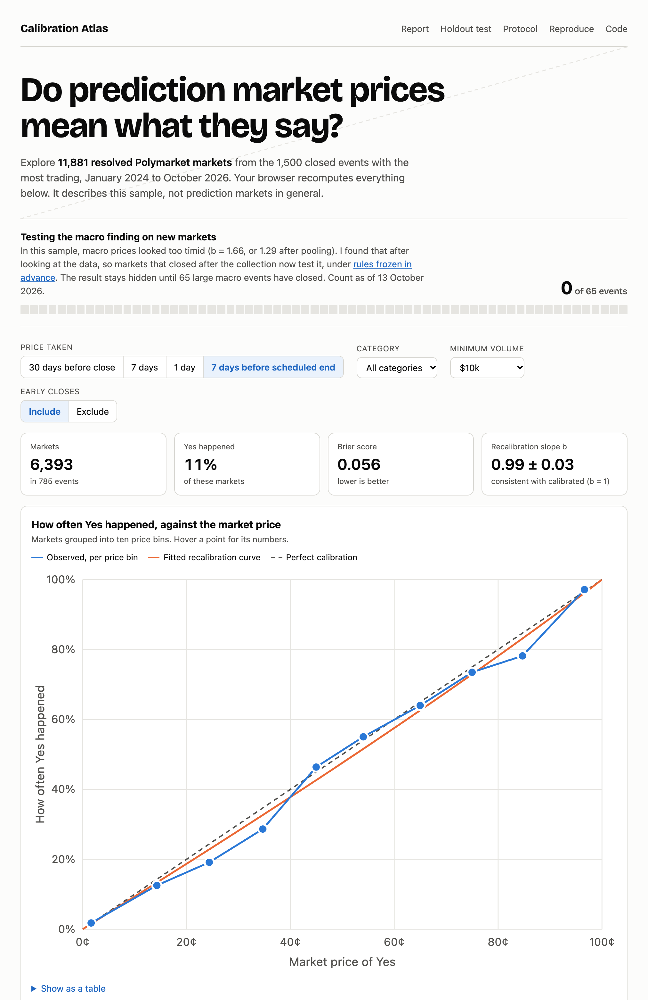

<picture><source media="(prefers-color-scheme: dark)" srcset="assets/banner-dark.png"></picture>

# Calibration Atlas

A calibration study of 11,881 resolved Polymarket markets that you can reproduce, with a test registered in advance for the one finding that survived.

[](https://github.com/Guinerve/calibration-atlas/actions/workflows/ci.yml)


[](reports/HOLDOUT.md)


| [**Read the report**](reports/REPORT.md) | [**Open the explorer**](https://guinerve.github.io/calibration-atlas/) | [**Holdout test**](reports/HOLDOUT.md) | [**Reproduce it**](#reproduce) |
|---|---|---|---|
| Every table, interval and chart | Refit the slope live, by horizon and category | The macro finding, on new markets | `uv run calatlas report` |

People read a prediction market price as a probability: 70¢ means a 70% chance. I wanted to check if that holds, so I measured it on 11,881 markets that have already settled. Along the way, two analysis bugs produced findings that looked publishable. I caught both, and this README explains them. One finding survived the fixes, and it is now under a test with rules fixed in advance.

## Results

Everything below describes **one sample**: 11,881 markets from the 1,500 closed Polymarket events with the most trading. They closed between January 2024 and October 2026, and I collected them on 12 October 2026. I analysed them after looking at the data. So these are findings about these markets, not about prediction markets in general.

| In this sample | Result | Status |
|---|---|---|
| **A week before the scheduled end, prices were well calibrated** | Recalibration slope b = **0.99 ± 0.03** (b = 1 is perfect), Brier score 0.056, across 6,393 markets in 785 events. | Exploratory |
| **Macro markets looked too timid** | Fitted alone, b = **1.66** (95% interval 1.21 to 2.10). Macro favourites priced 50¢ to 95¢ won 26 of 30 times; their prices implied about 21. Partial pooling shrinks b to **1.29** (0.91 to 1.81). | [Under a test fixed in advance](#the-holdout-test) |
| **Political prices leaned slightly overconfident** | b = **0.89** (0.81 to 0.98), and 0.90 (0.82 to 0.99) after pooling. | Exploratory |
| **The one strategy I tested made no reliable profit** | It refits monthly and trades the gap a week before the scheduled end. It made **+0.8¢ per contract** after a 1¢ cost, 95% interval −1.3¢ to +3.0¢. 395 of its 1,117 trades fall in one month. | Exploratory |

The macro result is a lead, not a settled fact. It comes from 65 events, and after pooling its interval reaches 1.

The last row covers one strategy at one cost. It does not show that no strategy could profit. I did not try other signals, timings, sizing or execution.

"Macro" is a group of tags. It covers the economy, the Fed, inflation and jobs data. It also covers finance, business, stocks and earnings markets.

## The holdout test

I found the macro result after looking at the data, in only 65 events, and pooling halves its distance from 1. So I am testing it on data that did not exist when I found it: **markets that closed after the collection**. The rules are frozen in [PROTOCOL.md](PROTOCOL.md), written the day after the collection.

* **Same population.** The primary test uses events at least as big as the smallest event in the original sample ($5.77M traded). A secondary test drops that minimum.
* **Read once.** The test reads the first 65 such events to close, the same size as the original sample. An event counts a week after it closes, once it has settled. Until then, [`HOLDOUT.md`](reports/HOLDOUT.md) and the explorer show only a count, so nobody can stop the test early on a convenient result. If 65 events have not closed by 31 December 2027, the test reads what there is and marks the result underpowered.
* **Verdict fixed in advance.** *Supported* if the one sided 95% lower bound on b is above 1. *Reversed* if the 95% interval lies below 1. Otherwise *not supported*. With 65 events, the test has about 90% power if the true slope is 1.66 and 36% if it is 1.29. So *not supported* would mainly rule out an effect as large as the first measurement.
* **Changes are visible.** A SHA-256 fingerprint covers the code of every rule that picks markets, reads prices, fits the slope or reads the holdout. CI fails if the fingerprint drifts from the one in `PROTOCOL.md`. A rule can change only through a dated amendment in that file.

**Status:** the badge at the top shows the live count, and [`HOLDOUT.md`](reports/HOLDOUT.md) shows the details. A [scheduled workflow](.github/workflows/holdout.yml) runs `calatlas holdout` on the 1st of each month and commits the new count. It reads the test once 65 events have settled (or at the deadline), then switches itself off. In the original sample, about five macro events of this size closed each month in 2026. So I expect the test to read in late 2027.

## Two bugs that made findings

Both bugs produced plausible results that I could have published. I fixed each one, and a test now pins each fix.

### 1. Lookahead in the trade timing

The first backtest traded every market 7 days before it closed, and it **bought Yes in 100% of trades**. That was the clue.

Nobody knows "7 days before it closed" at that time. 38% of markets close early. "Will X happen by June 30?" closes the moment X happens in May. When the actual close picks the trade time, the strategy uses information from the future. It quietly favours markets that are about to resolve Yes. The fitted intercept learned that, so the strategy bought Yes every time.

The fix is to decide at a time known in advance: **7 days before the scheduled end**, for markets still open then. The Yes share drops to 8.8%, and two category effects disappear:

| Category | b, timed from the actual close (leaks the future) | b, timed from the scheduled end |
|---|--:|--:|
| Sports | 1.20 (1.02 to 1.37) | 1.06 (0.86 to 1.26) |
| Crypto | 0.82 (0.66 to 0.97) | 0.97 (0.77 to 1.17) |
| Politics | 0.94 (0.83 to 1.04) | 0.89 (0.81 to 0.98) |
| Macro | 1.57 (1.16 to 1.97) | **1.66 (1.21 to 2.10)** |

The code keeps both timings (`walk_forward(timing="close")`), so you can reproduce the comparison:

<picture><source media="(prefers-color-scheme: dark)" srcset="reports/figures/backtest-dark.png"></picture>

### 2. A clip that flattened the long shots

The recalibration takes logit(price), so the code clips prices away from 0 and 1. I first clipped at 1¢. But **46% of markets were priced under 1¢** at decision time, and Polymarket quotes down to 0.05¢. The clip gave a 0.1¢ long shot and a 0.9¢ one the same value. Almost all of them resolved No, and the fit read that as prices being too timid.

| Measure | Clipped at 1¢ | Clipped at 0.05¢ (no real price changed) |
|---|--:|--:|
| b, 7 days before scheduled end | 1.07 ± 0.03 | **0.99 ± 0.03** |
| b, 1 day before close, early closes left out | 1.20 ± 0.04 | **1.09 ± 0.04** |
| b, macro | 1.71 ± 0.21 | **1.66 ± 0.23** |

My first draft of this README led with "favourites are underpriced the day before close". Most of that effect came from the clip. The macro result survives both fixes, but partial pooling (below) makes it smaller.

## Calibration by horizon

<picture><source media="(prefers-color-scheme: dark)" srcset="reports/figures/reliability-dark.png"></picture>

*How often Yes happened against the market price, 30, 7 and 1 day before close. Points on the dashed line are perfectly calibrated. Prices taken from the actual close can see early resolutions coming. That is why the headline numbers use the scheduled end.*

## Categories, alone and pooled

<picture><source media="(prefers-color-scheme: dark)" srcset="reports/figures/category_slopes-dark.png"></picture>

First, I fit each category's slope alone. But five categories is a small family, and chance alone will now and then give one extreme value like macro's, from just 65 events. A **Bayesian hierarchical model** estimates how much the categories really differ. It then pulls each estimate toward the shared mean, more strongly when the estimate is noisy:

* Politics, with 312 events and a tight estimate, barely moves (0.89 to 0.90) and stays below 1.
* Macro moves the most (1.66 to 1.29), and its credible interval now reaches 1.
* The prior on the spread between categories matters for macro. A prior four times tighter gives 1.13; four times looser gives 1.33. The other categories move by 0.02 at most. The report has the full table.

The model starts from each category's estimate and its standard error, clustered by event. So it still accounts for the correlation between markets in one event. The shared mean has a conjugate prior, so `pooling.py` computes the posterior exactly on a grid instead of by MCMC. It runs in under a second and has no sampler to tune.

## Interactive explorer

**[guinerve.github.io/calibration-atlas](https://guinerve.github.io/calibration-atlas/)** recomputes the results live in your browser. You can change the horizon, the category, the minimum volume and whether early closes count. It shows the reliability diagram, the Brier score and the recalibration slope, with errors clustered by event. It also tracks the holdout count. A test checks that its JavaScript fit matches the Python analysis to six decimal places.

<a href="https://guinerve.github.io/calibration-atlas/"><picture><source media="(prefers-color-scheme: dark)" srcset="assets/explorer-dark.png"></picture></a>

## Method

[PROTOCOL.md](PROTOCOL.md) has the full rules, frozen. In short:

**Data.** I used Polymarket's public Gamma API (closed events with their markets and tags) and its CLOB price history, collected on 12 October 2026. The sample is the 1,500 closed events with the most trading, with markets closing between January 2024 and October 2026. The code caches every response on disk with its download time.

**Selection.** A market enters if it is a Yes/No market, settled cleanly at 1 or 0, with at least $10,000 traded. The rules leave out team markets ("Lakers vs Celtics") and disputed or partial settlements. Nobody picks markets by hand.

**Prices.** The price is the last published price at or before each cutoff, never after it. The 30 and 7 day prices may be up to a day old (12 hourly data). The 1 day price must be within 3 hours (hourly data). A market without a recent enough price drops out of that horizon. The report gives the coverage at each horizon.

**Scores.**
* Brier score, with the Murphy decomposition into reliability (miscalibration), resolution (how well prices separate outcomes) and uncertainty.
* A logistic recalibration, logit(P(Yes)) = a + b·logit(price). If b is above 1, prices are too timid at the extremes.

**Uncertainty.** Markets inside one event are strongly correlated, for example one winner among 30 candidates. So standard errors are clustered by event, and bootstrap intervals resample whole events.

**Pooling.** b_hat ~ Normal(b, se), b ~ Normal(mu, tau), mu ~ Normal(1, 1), tau ~ HalfNormal(0.5). A category enters the model if it has at least 100 markets in at least 10 events.

**Backtest.** Each month, refit the recalibration on markets that had **already resolved**. Then trade the markets whose decision time falls in that month. Buy whichever side the recalibrated probability favours by more than the cost. Settle on a $1 contract, with a flat cost of 1¢ per contract (half spread plus fees).

## How I know it's right

The tests check the properties that would make the results wrong if they broke:

* **Parameter recovery.** I simulate markets with a known bias (a, b) and fit them. The true values come back within three standard errors, plus a 0.02 allowance. Prices below 1¢ keep their own logit.
* **Clustering works.** Duplicating markets inside an event does not shrink the standard errors or the bootstrap interval.
* **No future information.** Flipping every outcome after a cutoff leaves every earlier trading decision unchanged. This holds even when markets settle weeks after their scheduled end. A second test checks that the first one fails if training uses the scheduled end instead of the actual settlement. The code never reads a price past its cutoff, and never trades a market that had already closed at decision time.
* **The strategy finds a real edge and invents none.** On simulated biased prices it makes a profit. On calibrated prices it does not.
* **Pooling helps, and the maths is exact.** On simulated families of categories, pooled slopes land closer to the truth than slopes fitted alone. A precise category keeps its estimate, and a real difference survives. A test checks the closed form likelihood against scipy's multivariate normal density.
* **The rules are frozen.** The fingerprint of the code must match `PROTOCOL.md`. Changing a threshold, a tag list or a rule function changes it. A test recomputes the claim under test from the committed data, so the protocol cannot misquote it.
* **Nobody can peek at the holdout or move it.** While it is blinded, no output contains a slope. Once it is read, adding later events with a very different slope leaves the verdict unchanged. These never count toward the primary test: markets already in the study, markets closed before the cutoff, and events below the minimum size. A simulated real effect is *supported*; a calibrated market is not.
* **The explorer agrees with the analysis.** In CI, a test checks the browser's slope, clustered errors, Brier score and bins against the Python versions. If a subset has no stable fit, the explorer says so and shows no runaway slope.
* **The Murphy terms add up** to the Brier score, and calibrated forecasts score near zero reliability.
* **Data collection.** The HTTP tests run on a mock transport. They cover paging, caching and retries on 429 and 5xx. Permanent errors raise, and failed downloads go to an errors file. The live holdout listing never comes from the cache. The original collection had zero failures.
* **The command line works.** A test runs `calatlas report` on simulated data and checks the report, the explorer data and the holdout page.

GitHub Actions runs the 97 tests and the `ruff` linter on every push. CI also rebuilds the report from the committed data and fails if the result differs from the committed files.

## Reproduce

You need [uv](https://docs.astral.sh/uv/). Node 22 is optional on your machine: two tests use it to check the explorer's statistics, and they skip without it.

```bash
git clone https://github.com/Guinerve/calibration-atlas && cd calibration-atlas
uv sync
uv run calatlas report    # rebuild the reports, every chart and the explorer data (seconds, no network)
uv run pytest             # 97 tests, no network
```

That is the full reproduction. The repo includes `data/study.csv` (one row per market) and `data/holdout.csv`, so nothing needs the API. Optional extras:

```bash
python3 -m http.server 5196 --bind 0.0.0.0 --directory docs   # view the explorer at http://localhost:5196
uv run calatlas holdout                                       # download markets closed since the cutoff (minutes)
uv run calatlas collect --max-events 1500 --workers 6         # download the original sample again (about 45 minutes)
uv run calatlas fingerprint                                   # print the protocol fingerprint of the current code
```

A fresh collection makes about 24,000 requests and caches them in `data/raw/`, so a second run is instant.

## Repository map

| Path | What it is |
|---|---|
| [`reports/REPORT.md`](reports/REPORT.md) | The full results, rebuilt by `calatlas report` |
| [`reports/HOLDOUT.md`](reports/HOLDOUT.md) | The macro test and its current status |
| [`PROTOCOL.md`](PROTOCOL.md) | The frozen sampling rules, holdout design and fingerprint |
| [`docs/`](docs) | The explorer, served by GitHub Pages (`stats.js` holds its statistics) |
| `data/study.csv`, `data/holdout.csv` | One row per market; `collection.json` and `holdout.json` record when |
| `src/calibration_atlas/fetch.py` | Polymarket API client with a disk cache and retries |
| `src/calibration_atlas/dataset.py`, `markets.py` | Selection rules, horizon prices, the decision price |
| `src/calibration_atlas/collect.py` | Builds `study.csv` and `errors.csv` |
| `src/calibration_atlas/metrics.py` | Brier score, Murphy decomposition, reliability table, cluster bootstrap |
| `src/calibration_atlas/recalibration.py` | Logistic recalibration with clustered errors; market simulator |
| `src/calibration_atlas/pooling.py` | Bayesian hierarchical pooling of the category slopes |
| `src/calibration_atlas/backtest.py` | Walk forward refit and trading |
| `src/calibration_atlas/protocol.py`, `holdout.py` | The frozen protocol, its fingerprint, and the holdout test |
| `src/calibration_atlas/report.py`, `explorer.py` | Charts (light and dark), `REPORT.md`, and the explorer data |

## Limits

* **One sample.** The 1,500 closed events with the most trading are liquid markets, not all markets. Lifetime volume is known only afterwards, so the selection looks back in time. The decision time avoids the worst of this, but not all of it.
* **Exploratory.** I found every result except the holdout after looking at the data. Only the macro slope is under test on new markets. Nobody has replicated the rest.
* **One strategy, one cost.** Prices come from Polymarket's published price history, not from bid and ask quotes you could trade on. The flat 1¢ cost is an assumption. Real fills on thin markets would cost more, which makes the result for this strategy stronger. The backtest leans on one month: 395 of its 1,117 trades fall in June 2026.
* **Categories come from event tags**, which are imperfect, and "macro" is broad. Only 43% of markets have a price 30 days before close, because many markets are younger than that.
* **One venue.** This is research on public data that the code reads only. I placed no trades, and nothing here is trading advice.

## Roadmap

* Read the holdout once 65 primary events have closed.
* Add Kalshi as a second venue, and leave out its combination markets with several legs.
* Pool the intercept as well as the slope, and let the category effects vary with the horizon.

## Citing and licence

To cite this work, use [`CITATION.cff`](CITATION.cff). GitHub's "Cite this repository" button reads it. The code is under the MIT licence.
