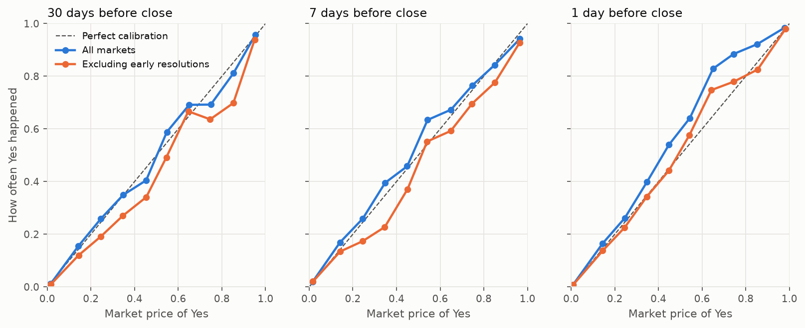
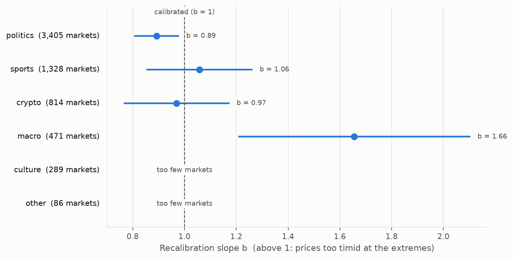
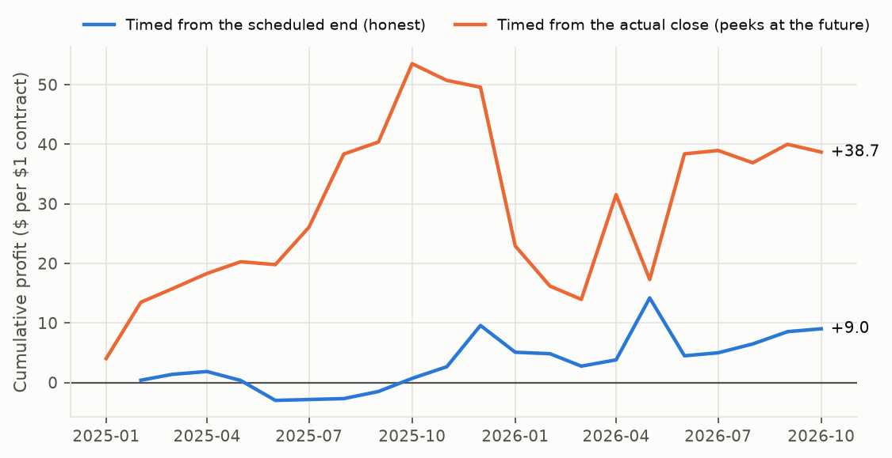

# Calibration atlas: results

Generated 12 October 2026 from Polymarket public data collected 12 October 2026. Every number below is recomputed by `calatlas report`.

## Scope

These results describe **one sample**: 11,881 markets from the highest-volume closed Polymarket events, closing between January 2024 and October 2026. They were analysed after looking at the data, so they are exploratory: they say how these markets behaved, not how prediction markets behave in general. The backtest tests **one strategy**; its result says nothing about strategies it did not try. The macro result is being tested on markets that closed after the collection, under rules frozen in advance ([HOLDOUT.md](HOLDOUT.md), [PROTOCOL.md](../PROTOCOL.md)).

## Sample

- **11,881 markets** in **1,170 events**: resolved Yes/No Polymarket markets that settled cleanly at 1 or 0, with at least $10,000 traded, from the 1,500 highest-volume closed events. The rules are frozen in [PROTOCOL.md](../PROTOCOL.md).
- **38% resolved early** (closed over a day before their scheduled end, usually because the event had already happened). Their late prices already know the answer, so every result is shown with and without them.
- Price coverage: 43% of markets have a price 30 days before close, 79% of markets have a price 7 days before close, 97% of markets have a price 1 day before close. A market is left out of a horizon when it is younger than the horizon or has no price point fresh enough.
- Yes happened in **16.5%** of markets: multi-outcome events contribute many long shots.

## Calibration by horizon

<picture><source media="(prefers-color-scheme: dark)" srcset="figures/reliability-dark.png"></picture>

| Horizon | Sample | Markets | Events | Brier (95% CI) | Reliability | Resolution | a | b (± s.e.) |
|---|---|--:|--:|---|--:|--:|--:|---|
| 30 days before close | all | 5,108 | 605 | 0.056 (0.049–0.064) | 0.0002 | 0.0537 | -0.02 | 1.04 ± 0.04 |
| 30 days before close | excl. early | 2,859 | 490 | 0.064 (0.056–0.072) | 0.0017 | 0.0485 | -0.35 | 1.01 ± 0.05 |
| 7 days before close | all | 9,433 | 973 | 0.063 (0.057–0.070) | 0.0004 | 0.0626 | 0.12 | 0.97 ± 0.04 |
| 7 days before close | excl. early | 5,983 | 830 | 0.063 (0.057–0.069) | 0.0011 | 0.0520 | -0.27 | 0.91 ± 0.04 |
| 1 day before close | all | 11,580 | 1,155 | 0.046 (0.041–0.051) | 0.0014 | 0.0898 | 0.43 | 1.18 ± 0.05 |
| 1 day before close | excl. early | 7,186 | 999 | 0.052 (0.047–0.056) | 0.0002 | 0.0689 | 0.06 | 1.09 ± 0.04 |
| 7 days before scheduled end | open then | 6,393 | 785 | 0.056 (0.051–0.061) | 0.0003 | 0.0446 | -0.10 | 0.99 ± 0.03 |

**Reading the table.** Brier is the mean squared error of the price as a forecast (lower is better). Reliability measures miscalibration (lower is better); resolution measures how well prices separate what happened from what didn't (higher is better). The recalibration fit is logit(P(Yes)) = a + b·logit(price): **b above 1 means prices are too timid at the extremes** (favourites win more often, and long shots less often, than their prices say). Standard errors and intervals are clustered by event. The last row measures every market at a time known in advance (7 days before its scheduled end, if it was still open then); "before close" rows rely on the actual close, which an early resolution only reveals afterwards.

## By category

Recalibration slope 7 days before the scheduled end (markets still open then), the backtest's decision time. Each category is fitted alone, with 95% intervals clustered by event, and then partially pooled by a Bayesian hierarchical model: the true slopes are treated as draws around a shared mean, so a noisy estimate is pulled toward the others while a precise one keeps its value. Categories come from event tags; "macro" covers finance, business, stocks and earnings as well as economic data and the Fed.

<picture><source media="(prefers-color-scheme: dark)" srcset="figures/category_slopes-dark.png"></picture>

| Category | Markets | Events | b alone (95% CI) | b partially pooled (95% credible) |
|---|--:|--:|---|---|
| politics | 3,405 | 312 | 0.89 (0.81 to 0.98) | 0.90 (0.82 to 0.99) |
| sports | 1,328 | 293 | 1.06 (0.86 to 1.26) | 1.04 (0.87 to 1.23) |
| crypto | 814 | 81 | 0.97 (0.77 to 1.17) | 0.98 (0.80 to 1.16) |
| macro | 471 | 65 | 1.66 (1.21 to 2.10) | 1.29 (0.91 to 1.81) |
| culture | 289 | 30 | 0.91 (0.66 to 1.16) | 0.94 (0.72 to 1.16) |
| other | 86 | 4 | too few events | – |

- Shared mean slope: **1.03** (0.78 to 1.35). Spread between categories (tau): median 0.20 (0.02 to 0.63). A category not seen here could plausibly have a slope from 0.40 to 1.73.
- Model: b_hat ~ Normal(b, se), b ~ Normal(mu, tau), mu ~ Normal(1, 1), tau ~ HalfNormal(0.5), solved exactly on a grid over tau (see `pooling.py`).

**Prior check.** With only a handful of categories, the prior on tau matters. Pooled slopes under a prior four times tighter and four times looser than the default:

| Category | tau prior scale 0.125 (4x tighter) | 0.5 (default) | 2.0 (4x looser) |
|---|--:|--:|--:|
| politics | 0.91 | 0.90 | 0.90 |
| sports | 1.02 | 1.04 | 1.04 |
| crypto | 0.98 | 0.98 | 0.98 |
| macro | 1.13 | 1.29 | 1.33 |
| culture | 0.96 | 0.94 | 0.94 |

## Walk forward backtest

Each month the recalibration is refitted using only markets that had **already resolved**, then used to trade markets 7 days before their **scheduled** end, buying whichever side the recalibrated probability favours by more than the cost. The scheduled end is known in advance; the actual close is not, because many markets close early. The second line times the same strategy from the actual close, which quietly peeks at early resolutions; it is shown only to measure how much that flatters the result. Cost assumed: 0.01 per contract (half spread plus fees), on a $1 payout contract.

<picture><source media="(prefers-color-scheme: dark)" srcset="figures/backtest-dark.png"></picture>

| Timing | Trades | Events | Months | Mean profit per contract (95% CI) | Winning trades | Bought Yes |
|---|--:|--:|---|---|--:|--:|
| Timed from the scheduled end (honest) | 1,117 | 448 | Feb 2025 to Oct 2026 | **+0.0081** (-0.0133 to +0.0295) | 66.0% | 8.8% |
| Timed from the actual close (peeks at the future) | 3,307 | 719 | Jan 2025 to Oct 2026 | **+0.0117** (-0.0074 to +0.0335) | 30.2% | 100.0% |

Intervals resample whole events.

**What this shows.** This strategy, at this cost, on these markets, made +0.8¢ per contract with a 95% interval of -1.3¢ to +3.0¢: not distinguishable from zero. It does not show that no strategy could profit: other signals, timings, sizing or execution were not tried, and the cost is an assumption. 395 of the 1,117 trades fall in June 2026, so one month carries much of the weight.

## Limits

- Prices are Polymarket's published price history, not executable bid/ask quotes; the backtest's flat cost is an assumption, and real fills on thin markets would be worse.
- The sample is the 1,500 highest-volume closed events, so it describes liquid markets, not all of them. Lifetime volume is only known afterwards, so the selection looks back.
- Results were found after looking at the data. Only the macro slope is being tested on new data ([HOLDOUT.md](HOLDOUT.md)); the rest has not been replicated.
- One venue, one strategy, one cost assumption. The backtest leans on few months: intervals resample events, not time periods.
- Markets in one event are correlated; intervals are clustered by event, but categories are assigned from event tags, which are imperfect.
- Research on read only public data. Nothing here is trading advice.
